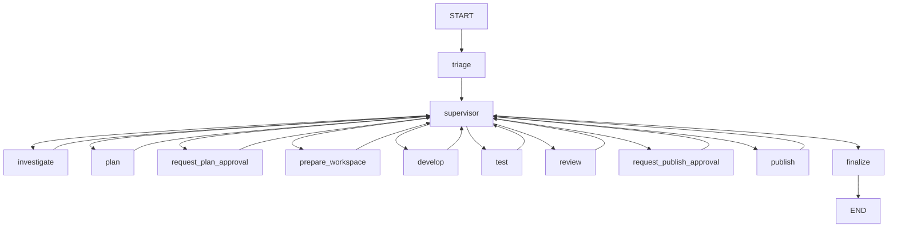

# Architecture

PatchPilot is a local-first maintenance loop. PostgreSQL stores the bug report, the audit trail, and the human decisions. A worker, not the API, runs the agents. Generated code is applied only in a private worktree, and pytest runs in a separate process that has no database or model credentials.

The API is published on `127.0.0.1:8000`. Registered source checkouts are mounted read-only. Git metadata for a task is written only under the workspace volume.

```mermaid
flowchart LR
  person[Person]
  api[FastAPI API and dashboard]
  db[(PostgreSQL tasks, events, approvals)]
  worker[Worker]
  graph[LangGraph supervisor]
  sources[Read-only checkouts]
  work[Private worktrees]
  runner[Restricted pytest runner]
  ollama[Optional local Ollama]

  person --> api
  api --> db
  worker --> db
  worker --> graph
  graph --> sources
  graph --> work
  worker --> jobs[Runner job volume]
  runner --> jobs
  worker -.-> ollama
```

The runner reads a copy of the worktree from the shared runner volume. It does not mount the registered checkout or the database.

## Workflow

Every specialist node returns to `supervisor`. The rules choose the next node. A task with no repository finalizes after triage. A task with a repository is investigated and planned. A plan that names a code change pauses until a person approves it. Approval creates the worktree. The patch, the tests, and the review then run. Publication, when it is configured, pauses a second time before any push.



`investigate_more`, `replan`, and `repair` are further trips through `investigate`, `plan`, and `develop`. They are capped: one extra investigation, one replan, and two repairs. Escalation ends at `finalize` with a failed task.

## Where state lives

| Record | Store | Who writes it |
| --- | --- | --- |
| Task, run, event, approval, publication | PostgreSQL, Alembic | API for create and decisions; worker for stage updates |
| Graph thread | PostgreSQL checkpoint tables from `AsyncPostgresSaver.setup()` | Worker |
| Plan, proposal, diff, test report, review | `artifacts` volume plus an `artifacts` row | Worker writes; API reads |
| Clone and worktree | `workspaces` volume plus a `workspaces` row | Worker |
| Pytest job | `runner` volume | Worker writes the request; runner writes the result |

Checkpoint tables are not Alembic revisions. The thread id is the task UUID.

## Processes

| Process | Credentials | Network |
| --- | --- | --- |
| API | Database URL. No model key and no GitHub token. | localhost:8000 |
| Worker | Database URL. Model and GitHub settings only when those features are enabled. | Database, and Ollama on the host only if you opt in |
| Runner | None. It exits if a secret is present. | `network_mode: none` |

Decisions for this split are in `docs/adr/`.
